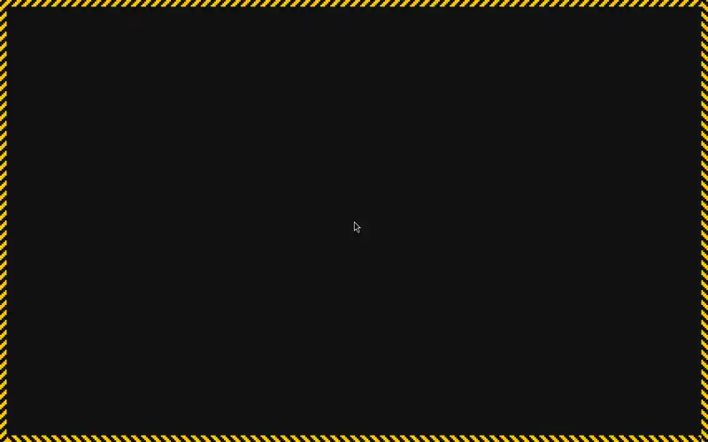
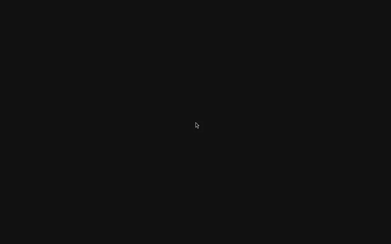

# hyprhands

**Give an AI agent hands on your Hyprland desktop, and keep the steering wheel.**

hyprhands lets a program see the screen, read what apps say is on it, move the pointer, click
and type, in any app on a Hyprland desktop: terminals, editors, file managers, settings, games,
browsers. It is built for agent loops, so it is fast, it never touches your config, and it
stops the instant you reach for the mouse.



<sub>A real run, recorded in a VM: one agent drives three different apps. The hazard tape,
the robot cursor, the click ripples, the motion tail and the captions are hyprhands telling the
person at the desk what it is doing.</sub>

## What it can do

| | |
|---|---|
| **See** | Capture the screen or a region, sent as raw QOI bytes, never base64. |
| **Read** | Walk an app's accessibility tree and return it as XML, plus the visible text as lines, so an agent can often skip OCR. |
| **Act** | Move, click, scroll, press key combos and type any Unicode text, independent of your keyboard layout. |
| **Manage apps** | Launch an app and wait for its window, focus or bring a window, find one by class. |
| **Work anywhere** | One process per session speaking a small framed protocol on stdio, so `ssh desk hyprhands serve` works the same as running it locally. |

## You stay in charge



- **Grab the mouse and it stops.** If the pointer drifts more than 64 px from where hyprhands
  left it, or focus moves to another monitor, the session latches stopped and refuses every
  later input. `hyprhands stop` does the same from a terminal.
- **It is always obvious.** While a session drives a monitor you get a marching tape frame, a
  robot badge on your cursor, a ripple at every click, a caption saying what it is doing, and
  one desktop notification. All of it is click-through and disappears with the process.
  Captures hide the overlay, so the agent never sees it.
- **Your config is read, never written.** hyprhands reads your binds over IPC and refuses to
  send a combo your compositor would swallow as a bind (say `SUPER+Q`), unless the agent
  explicitly asks to trigger it.

## Get started

Build it (Rust, edition 2024):

```sh
cargo install --path .
```

Arch users can build the package in `packaging/arch`.

Check what your session supports:

```sh
$ hyprhands doctor
[ok]   hyprland     instance efb509937800, Lua dispatchers
[ok]   monitor      Virtual-1 at 0,0 1280x800 scale 1 ws 1
[ok]   config       48 binds, 3 keyboards, read only
[ok]   cursor       focusing a window warps the cursor to its centre; warp on workspace change 0, on monitor change null, back after keys false; follow_mouse 1
[ok]   wayland      screencopy, virtual pointer and keyboard bound; outputs ["Virtual-1"]
[ok]   a11y         AT-SPI bus up, 1 apps registered
```

Then start a session and talk to it. Each message is a 4 byte big endian length followed by
JSON; a reply that carries an image says how many raw bytes follow it.

```python
import json, struct, subprocess

hh = subprocess.Popen(["hyprhands", "serve"], stdin=subprocess.PIPE, stdout=subprocess.PIPE)

def call(**req):
    body = json.dumps(req).encode()
    hh.stdin.write(struct.pack(">I", len(body)) + body)
    hh.stdin.flush()
    (n,) = struct.unpack(">I", hh.stdout.read(4))
    reply = json.loads(hh.stdout.read(n))
    blob = hh.stdout.read(reply["blob"]) if "blob" in reply else None
    return reply, blob

call(op="launch", argv=["gnome-calculator"], caption="open the calculator")
call(op="click", x=367, y=695)
reply, qoi = call(op="screenshot")
call(op="type", text="hello, wörld ✓")
```

Run it on another machine by swapping the command for `["ssh", "my-desktop", "hyprhands", "serve"]`.

## Commands

```
hyprhands serve [--monitor NAME]    the protocol on stdio (requests below)
          [--tolerance PX]          how far the pointer may drift before it counts as you (64)
          [--theme NAME|FILE]       overlay look: construction (default) or adaptive
          [--no-overlay] [--no-notify] [--tint]
hyprhands doctor                    what this session can and cannot do
hyprhands stop                      refuse all input until the next session
hyprhands restore-cursor            put your cursor theme back after a crash
hyprhands bench [--monitor NAME]    read-only timings, sends no input
hyprhands overlay-check             show the overlay and confirm captures stay clean
```

## Requests

| op | does |
|---|---|
| `hello`, `state` | the driven monitor; the agent's window, the cursor, and whether you took over |
| `screenshot` | `region` optional; replies with QOI bytes |
| `tree` | the accessibility tree as XML; `text: true` adds the visible lines |
| `config` | your loaded binds and keyboard options |
| `find_window` | a window's address by `class` |
| `move`, `click`, `scroll` | `x`, `y` in the monitor's logical px; `button`, `notches` |
| `key` | a `combo` like `ctrl+shift+t`; `allow_bind` to trigger one of your binds |
| `type` | any Unicode `text` |
| `launch`, `spawn` | an `argv`; `launch` waits for its window |
| `focus`, `bring` | a window by `address`; `bring` moves it to the driven monitor |

Every input request takes an optional `caption`, shown on screen while it runs.
`src/proto.rs` and `src/server.rs` are the reference.

## Themes

The overlay look is a theme. `construction` (the default) is 8 bit hazard tape in hi vis yellow
and black, turning to red and white barrier tape when stopped. `adaptive` is smooth and takes
the complement of your window border colour. Your own goes in
`~/.config/hyprhands/themes/NAME.toml` and extends a built in one; `src/theme.rs` lists the keys.

## Accessibility notes

Apps that speak AT-SPI (GTK, Chromium, Electron and others) expose a tree. Chromium reports web content in buffer
pixels on a fractionally scaled monitor; hyprhands notices and scales it back. Apps without
accessibility (kitty, most games) answer `no_app`, so fall back to screenshots there.

## The demos

The clips above are real hyprhands sessions recorded in a QEMU VM with
[vmkit](https://github.com/MasonRhodesDev/vmkit) and
[hypr-qa](https://github.com/MasonRhodesDev/hypr-qa). `demo/*.toml` are the scenarios and
`demo/render` rebuilds every clip:

```sh
HYPR_QA=/path/to/hypr-qa/bin/hypr-qa demo/render
```

`tests/qa` holds the scenarios that check the overlay the same way.

## Credits

hyprhands learned from [hypruse](https://github.com/IlyasKhallouki/hypruse) and
[typesafe-computer-use](https://github.com/awlevin/typesafe-computer-use); see `NOTICE.md`.
MIT licensed.
